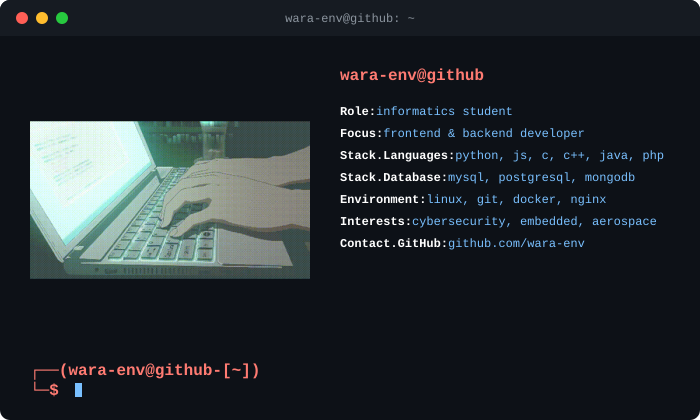

  

  

## Hi 👋, I'm Maheswara

### A passionate Frontend & Backend Developer from Indonesia 🇮🇩

---

## 👤 About Me

- 🪡 ***Just 1% better every day***
- 🌱 Currently learning **Frameworks, Databases, Networking, Embedded Systems, Cyber Security & DevOps**
- 🔐 Fast Learner and adaptation
- 👨‍💻 All my projects: [Google Drive](https://drive.google.com/drive/folders/1WQqAPtzjl_4oz5VDq2egTdhK24U0Hmne)
- 📫 Reach me: **4studyan25@gmail.com**
- ⚡ Fun fact: I think I'm lazy but ambitious

---

# 💻 Tech Stack

<table>
  <tr>
    <th align="left">Kategori</th>
    <th align="left">Teknologi</th>
  </tr>
  <tr>
    <td><b>Bahasa</b></td>
    <td>
      
      
      
      
      
      
      
      
      
      
        
    </td>
  </tr>
  <tr>
    <td><b>Framework & Library</b></td>
    <td>
      
      
      
      
      
    </td>
  </tr>
  <tr>
    <td><b>Server & Database</b></td>
    <td>
      
      
      
      
      
    </td>
  </tr>
  <tr>
    <td><b>DevOps & Tools</b></td>
    <td>
      
      
      
      
      
      
      
      
    </td>
  </tr>
  <tr>
    <td><b>Hardware & Lainnya</b></td>
    <td>
      
      
      
    </td>
  </tr>
</table>

---

## 🌐 Connect with me

---

## 📊 GitHub Statistics

---

## 🐍 Contribution Snake

<picture>
  <source media="(prefers-color-scheme: dark)" srcset="https://raw.githubusercontent.com/wara-env/wara-env/output/github-snake-dark.svg" />
  <source media="(prefers-color-scheme: light)" srcset="https://raw.githubusercontent.com/wara-env/wara-env/output/github-snake.svg" />
  
</picture>
